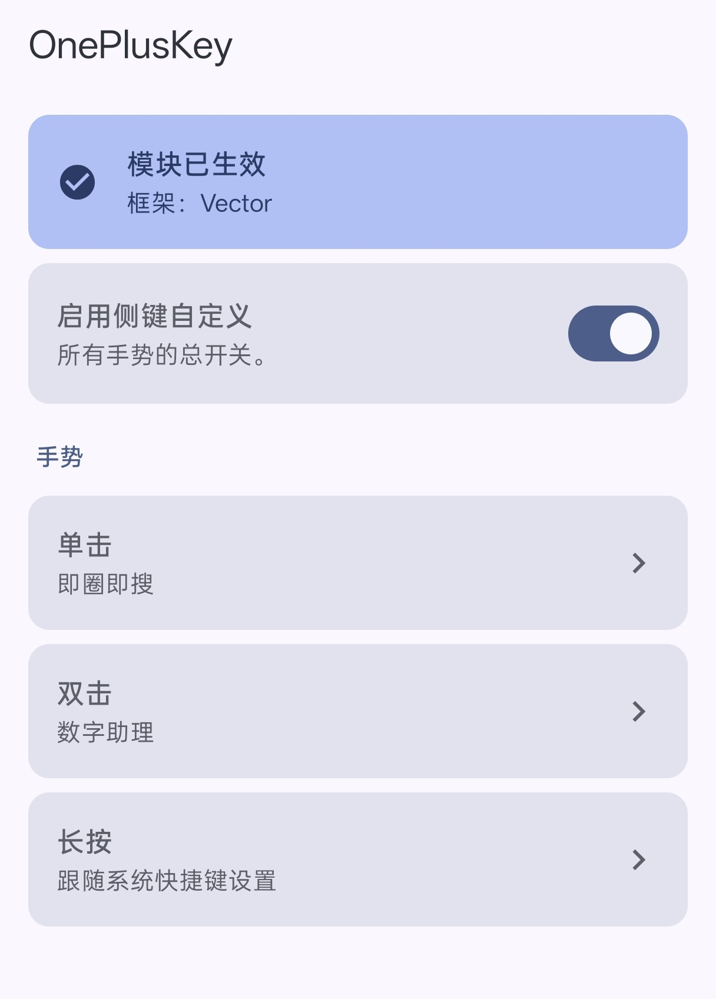
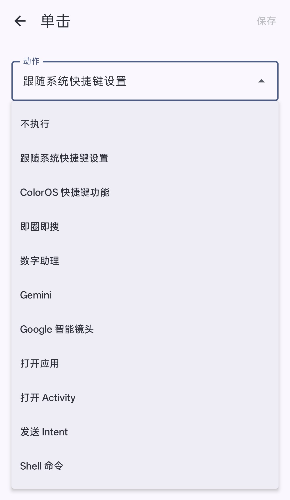
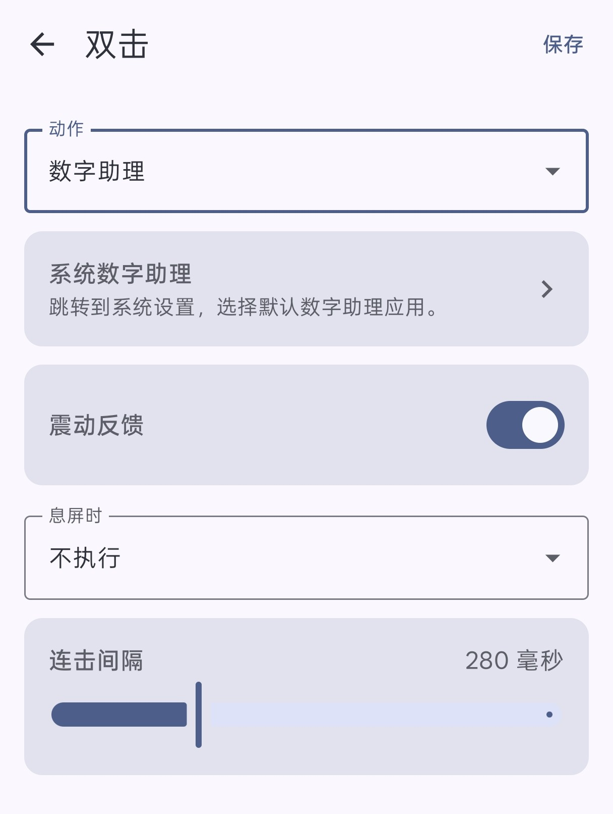

# OnePlusKey

**自定义一加 / ColorOS 侧键的功能**

---

OnePlusKey 通过 Hook 系统框架里的侧键监听逻辑，拦截侧键事件并按配置执行动作。  
除常见的打开 Activity、发送 Intent、执行 Shell 命令外，还添加了即圈即搜、数字助理、Google 智能镜头等功能。  
同时允许调用 ColorOS 内置的快捷键功能，或者将按键事件交给系统快捷键功能处理。

## 功能展示

### 主界面

顶部卡片显示模块是否已生效，下面是侧键自定义的总开关和手势列表。  
每项直接显示当前绑定的动作，点击进入编辑页。

### 动作选择

每个手势的动作都从这个下拉列表里选，从什么都不做到执行 Shell 命令，列出的动作均可直接使用：

- **动作类型**：
  - 跟随系统快捷键设置：按照按键触发方式，向系统快捷键服务发送按键事件，仅单击、双击会被处理
  - ColorOS 快捷键功能：临时将系统快捷键设置为特定的功能后触发长按事件；具体功能处理方式按照系统快捷键内的定义，如翻译功能内的屏幕翻译、拍照翻译等
  - 即圈即搜（Circle to Search）：对 Google app 伪装机型后触发屏幕搜索
  - 数字助理：触发已设定的默认数字助理
  - Gemini / Google 智能镜头：依赖 Google app 实现
  - 打开应用 / 打开指定 Activity / 发送 Intent / 执行 Shell 命令

### 手势设置
编辑页集中放置单个手势的全部选项：动作、震动反馈、息屏时的行为，以及触发延迟

- 每个手势可单独设置是否震动反馈、息屏时的行为（不执行 / 亮屏后执行 / 不亮屏直接执行）
- 长按时长、连击间隔分别在长按、双击的编辑页里调；编辑页改动点「保存」才生效
- 当选择数字助理时，提供设置系统数字助理的入口

## 测试环境
| 项目 | 版本 |
|---|---|
| 设备 | 一加 13T（PKX110） |
| 系统 | ColorOS PKX110_17.0.0.104(CN01B110P02)（Android 17） |
| Root | [Magisk 30.7](https://github.com/topjohnwu/Magisk/releases/tag/v30.7) |
| Xposed 框架 | [Vector v2.2](https://github.com/JingMatrix/Vector/releases/tag/v2.2) |
| Google App | [Google 17.68.20.ve.arm64](https://play.google.com/store/apps/details?id=com.google.android.googlequicksearchbox) |
## 致谢
- [OplusKeyHook](https://github.com/siowu/OplusKeyHook)：侧键拦截思路
- [Eta](https://github.com/Mangi-11/Eta)：测试时使用的自定义数字助理
- [Claude Code](https://claude.ai)：方案探索与代码编写
- [ばっどがーる](https://badgirl-anime.com)：等待代码编写和编译时看的动画
